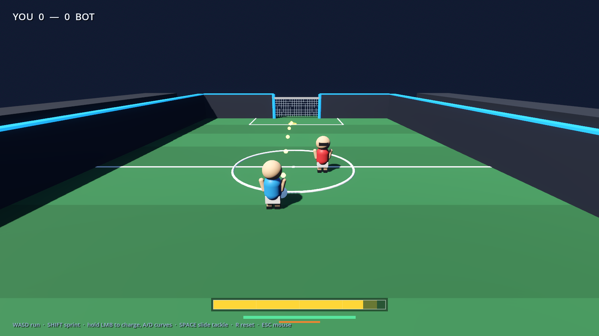

# ⚽ Mega Battle Football

A 2v2–4v4 arcade football game where nobody dies, everyone plays at once, and the
ball can be hit into the net with a rocket.

**Current build: M2 — 1v1 against an AI opponent, with slide tackles and
knockdowns.** No goalkeeper, no items yet.



📋 **Roadmap, locked rules and current tuning values:** [`docs/plan.md`](docs/plan.md)

## Run it

Godot **4.7.2** (installed via `winget install GodotEngine.GodotEngine`).

```bat
run.bat
```

Or open the project folder in the Godot editor and press F5.

## Controls

| Action | Keyboard / mouse | Gamepad |
|---|---|---|
| Run | WASD / arrows | Left stick |
| Sprint | Shift | RB / RT |
| Charge kick | Hold left mouse | Hold X |
| Curve the kick | A / D while charging | Left stick X while charging |
| **Slide tackle** | **Space** | **B** |
| Aim | Move the mouse | Right stick |
| Zoom camera | Mouse wheel | — |
| Reset match | R | — |
| Release mouse | Esc | — |

**Kick rules:** 0.75 s to full charge. 7 m/s at a tap, 24 m/s at full power.
Charging inside the **80–95 % sweet spot** gives 1.15× power, a gold trajectory
and a hit-stop. Overcharging past 95 % gives max power but no bonus — the meter
turns red.

## What is already in this build

- 32 × 20 m walled arena with markings, bleachers and night-stadium lighting
- **1v1 against an AI opponent** — it chases, dribbles at your goal, shoots and
  slide-tackles you. It is deliberately beatable.
- `CharacterBody3D` players: camera-relative movement, sprint with generous
  stamina (100 max, 14/s drain, 25/s regen), smooth turning
- **Slide tackle** with a 0.45 s slide, 1.1 s cooldown, knockdown on contact and
  a knockback that sends the victim sliding
- **Knockdowns**: 1.7 s down, can't act, then 1 s of protection on recovery
- **Magnetic dribbling**: the ball is held slightly ahead and to your right,
  trapped when you stand still; it breaks free when hit or kicked
- **Charge kick** with loft, curve and screen shake
- Dotted trajectory preview + landing ring
- Two goals with net, posts and detection areas; per-team score, banner, reset
- Shoulder-offset chase camera so the ball is never hidden behind your body
- HUD: charge meter with sweet-spot band, stamina, tackle cooldown, score

## Tuning knobs

Everything that matters is an `@export` on these scripts:

| File | Knobs |
|---|---|
| `scripts/player.gd` | speed, acceleration, stamina, dribble radius/grip, tackle speed/range/cooldown/knockback |
| `scripts/kick_controller.gd` | charge time, min/max power, sweet spot, loft, curve, kick range |
| `scripts/bot_brain.gd` | think interval, shoot range, tackle range/chance, aim error |
| `scripts/ball.gd` | mass, bounce (physics material), curve decay, rolling friction |
| `scripts/chase_camera.gd` | distance, pitch, shoulder offset, sensitivity, follow lag |
| `scripts/arena_builder.gd` | arena size, wall height, goal width |

Change values while the game is running is not supported yet — edit and restart,
or open the project in the editor and tweak the exported values on the running
scene.

## Project layout

```
project.godot
scenes/main.tscn          entry point (a single Node3D + main.gd)
scripts/
  main.gd                 builds the 1v1 sandbox, owns scoring/reset
  arena_builder.gd        floor, markings, walls, bleachers
  player.gd               movement, stamina, dribbling, tackles, knockdowns
  kick_controller.gd      charge/release, force_kick for the AI, preview
  ball.gd                 physics ball, curve force, rolling friction
  ball_trail.gd           speed ribbon
  chase_camera.gd         third-person shoulder camera
  goal.gd                 frame, net shader, detection area
  bot_brain.gd            AI decision making
  bot_input.gd            AI input source
  juice.gd                autoload: screen shake + hit-stop
  input_hub.gd            keyboard/mouse or gamepad input source
  ribbon.gd               immediate-mode ribbon helper
  ui/hud.gd               counters, banners
  ui/hud_painter.gd       charge meter, stamina, tackle bar
tools/
  capture.gd              screenshot
  test_play.gd            headless kick/goal/reset test
  test_move.gd            headless sprint/dribble/kick test
  test_tackle.gd          headless tackle/knockdown test
  test_bot.gd             headless AI test (bot plays alone)
  scripted_input.gd       fake input source
```

## Dev commands

```bat
godot --headless --path . --script tools/test_play.gd
godot --headless --path . --script tools/test_move.gd
godot --headless --path . --script tools/test_tackle.gd
godot --headless --path . --script tools/test_bot.gd
godot --path . --script tools/capture.gd --resolution 1600x900
```

## Design (locked decisions)

- 2v2–4v4, humans only, no match starts below 2v2
- 3 arenas × 2 min, 1 point per goal, cup by total, sudden death on a tie
- Walled arena, no out of bounds, small goals, no goalkeepers
- Stagger → Slip → Knockdown → Launch. **Nobody dies or respawns.**
- Getting hit while down is possible but knockback is halved
- Items: Rocket, Orbital Strike, Ball Bomb, Giant Boot, Banana Peels, Freeze Shot,
  Multiball, Shield Bubble. One slot, dropped when knocked down, friendly fire on
- Multiball is a rare item: 3 balls for 20 s or until a goal
- Listen-server netcode, room codes

## Next milestone (M3)

Match flow: 2-minute timer, kickoff countdown and a proper restart sequence. Then
local 2-player, then items.
